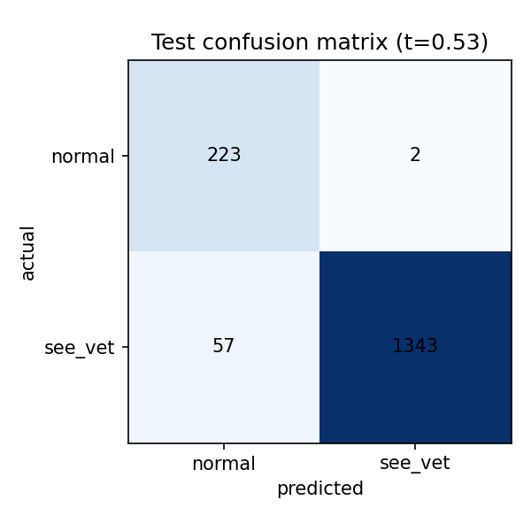
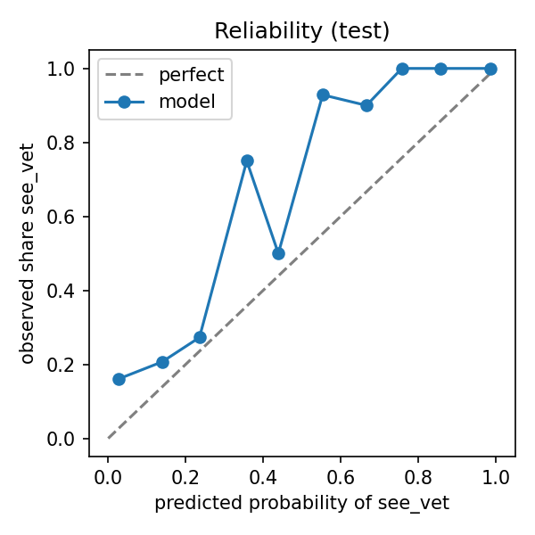

# Dog eye screening

Flag phone photos of dog eyes that may need a vet visit.

> **Not a diagnosis.** This is a portfolio project that screens for "looks normal" vs "see a vet". It does not identify diseases and must not replace a veterinary examination. If you are worried about your dog's eyes, see a vet.

[中文简介](#中文简介)

## Problem

Owners often notice something odd about their dog's eye and are unsure whether it needs a vet. The task here is a binary screen on a close-up photo of one eye:

| Output | Meaning |
| --- | --- |
| `normal` | No visible sign that needs a vet |
| `see_vet` | Possible problem; book a vet visit |

A missed problem is worse than a false alarm, so the model is tuned for **recall on `see_vet`** (target 95% on validation) and reports specificity, AUROC, AUPRC and calibration alongside it.

## Data

| Source | Use | Notes |
| --- | --- | --- |
| [Roboflow Universe, "Dog eyes" workspace](https://universe.roboflow.com/dog-eyes) | train / val / test | About 700 images per condition, CC BY 4.0. Provenance is not documented on Roboflow; the class list resembles Korea's AI Hub companion-animal eye dataset, which is unconfirmed. |
| [DogEyeSeg4](https://repository.inf.uniri.hr/islandora/object/infri:1309), University of Rijeka | external test (planned) | Vet-verified. Access requested from the authors. |

Label mapping lives in [`configs/labels.yaml`](configs/labels.yaml). Healthy maps to `normal`. Conjunctivitis, blepharitis, entropion, eyelid tumour, pigmented keratitis and "mastopathy" map to `see_vet`. Nuclear sclerosis is excluded for now: it is a common age-related change that is often harmless and easy to confuse with cataract, so it needs a vet's labelling rule first.

Images are not redistributed in this repo; the pipeline downloads them with your own Roboflow key.

## Method

1. **Crop** each image to the largest annotated eye box, plus a 15% margin ([`data.py`](src/dogeye/data.py)).
2. **Embed** each crop with frozen [DINOv2-small](https://huggingface.co/facebook/dinov2-small) ([`features.py`](src/dogeye/features.py)).
3. **Group near-duplicates** by original upload name, perceptual hash (≤ 6 bits apart) or embedding cosine similarity (≥ 0.97), then **split by group**, stratified by label, 70/15/15 ([`groups.py`](src/dogeye/groups.py)). Public image sets often contain flipped, re-encoded or augmented copies of the same photo; splitting by image would let copies leak into the test set and inflate scores.
4. **Train** a standardised logistic regression with balanced class weights, picking C on validation AUPRC. The decision threshold is the highest one that still reaches 95% recall on validation ([`train.py`](src/dogeye/train.py)).
5. **Evaluate** once on test: confusion matrix, recall, specificity, AUROC, AUPRC, expected calibration error, reliability diagram, and the flag rate per condition so you can see which diseases are missed ([`metrics.py`](src/dogeye/metrics.py)).

## Results

### v1: baseline after the leakage fix, 25 Oct 2026

Test split: 1,625 crops from 609 independent photo groups (75 healthy, 534 see_vet). Threshold 0.527, set on validation for 95% recall. Intervals are 95% bootstrap intervals over photo groups.

| Recall (see_vet) | Specificity | AUROC | AUPRC | ECE |
| --- | --- | --- | --- | --- |
| **95.9%** (94.1–97.5%) | **99.1%** (97.8–100%) | 0.986 | 0.998 | 0.045 |

Flag rate by condition (share sent to "see a vet"):

| Condition | Test crops | Flagged |
| --- | --- | --- |
| Eyelid tumour | 247 | 100% |
| Blepharitis | 249 | 99.6% |
| Conjunctivitis | 262 | 99.2% |
| Pigmented keratitis | 254 | 98.8% |
| "Mastopathy" | 176 | 94.3% |
| **Entropion** | 212 | **80.7%** |
| Healthy (false alarms) | 225 | 0.9% |

 

What this says:

- **Entropion is the weak spot.** It is an inward-rolling eyelid: a shape change rather than redness or discharge, and harder to see in a tight crop. It accounts for most of the misses.
- **The model is under-confident.** Observed see_vet rates sit above the predicted probabilities (reliability diagram), a side effect of balanced class weights. Calibrating on validation is a cheap fix before the probabilities are shown to users.
- **Fixing the leak barely moved the scores** (recall 93.9% to 95.9%, specificity unchanged). That makes copy leakage an unlikely explanation for the high numbers, which leaves the project-shortcut concern below as the main open question.

Full metrics: [`docs/results/v1/metrics.json`](docs/results/v1/metrics.json).

### v0: first run, 25 Oct 2026 (superseded)

Test split, 1,685 crops, threshold 0.865 set on validation for 95% recall:

| Recall (see_vet) | Specificity | AUROC | AUPRC | ECE |
| --- | --- | --- | --- | --- |
| 93.9% | 99.1% | 0.988 | 0.998 | 0.030 |

Flag rate by condition: blepharitis 99.6%, eyelid tumour 98.7%, conjunctivitis 97.7%, pigmented keratitis 96.9%, "mastopathy" 90.5%, **entropion 79.3%**; healthy eyes falsely flagged 0.9%.

**Why these numbers are not trusted.** Checking the test predictions showed that 175 of 1,377 original photos in the test split had augmented copies the hash and embedding links had *not* grouped together. The same miss almost certainly put copies of training photos into test, so v0 is optimistic. The split now also links images by their original upload name (Roboflow keeps it before `.rf.<hash>`). v1 above uses the fixed split.

Two more things to keep in mind when reading any result here:

- Each condition comes from a separate Roboflow project, so the model may partly learn *which project an image came from* (camera, lighting, crop style) rather than the disease. The external DogEyeSeg4 test and owners' own phone photos are the real check.
- Healthy eyes are only ~14% of the data, so precision is high almost by construction; recall and specificity are the numbers to read.

## Run it

The easiest way is the Colab notebook, which needs a free GPU runtime and a free [Roboflow API key](https://app.roboflow.com/settings/api):

[`notebooks/baseline_colab.ipynb`](notebooks/baseline_colab.ipynb)

Or locally:

```bash
pip install -e ".[data,features,dev]"
export ROBOFLOW_API_KEY=...
python -m dogeye.data --out data
python -m dogeye.features --manifest data/manifest.csv --out data/features.npz
python -m dogeye.groups --manifest data/manifest.csv --features data/features.npz --out data/manifest_split.csv
python -m dogeye.train --manifest data/manifest_split.csv --features data/features.npz --out runs/baseline
```

Tests use synthetic data and run on CPU in a few seconds:

```bash
pytest
```

## Limitations

- Labels come from a public dataset of unknown provenance and have not yet been audited by a vet.
- Training photos may differ from what owners take at home (lighting, angle, focus).
- Dogs only. Cats are planned as an out-of-distribution test.
- Duplicate grouping approximates "same dog"; the data has no animal IDs.

## Roadmap

- [x] Data survey and problem definition
- [x] Baseline: frozen DINOv2 + logistic regression (v1)
- [ ] Fine-tuned ConvNeXt / ViT, and a comparison with a multimodal LLM looking at the same photos
- [ ] Bilingual (English / Chinese) demo with FastAPI + Gradio, abstaining on uncertain or low-quality photos
- [ ] Model card, external test on DogEyeSeg4, cat-eye generalisation test

## 中文简介

这是一个作品集项目：用手机拍的狗眼照片，判断"看起来正常"还是"建议看兽医"，**不做诊断**。重点是严谨的评估：按近似重复图片分组划分数据集，避免准确率虚高；优先保证"建议看兽医"的召回率；报告置信度校准；并按病种列出漏检情况。

## License

Code is MIT licensed. Datasets keep their own licences.
